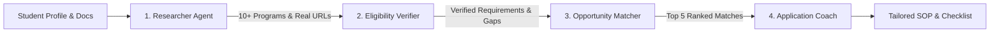

# ScholarSwarm AI 🎓
> **TetraNoodle AI Hackathon 2026** — Autonomous Multi-Agent Scholarship & University Finder

[](https://github.com/Vinay-Budde/scholarship)
[](https://opensource.org/licenses/MIT)
[](https://fastapi.tiangolo.com/)
[](https://reactjs.org/)
[](https://langchain-ai.github.io/langgraph/)

An AI agent swarm that automates university and scholarship research for students seeking master's degrees abroad. Four specialized agents collaborate to discover programs, verify eligibility criteria, rank best-fit options, and craft personalized Statements of Purpose (SOP) with deadline checklists.

---

## 📦 Hackathon Deliverables

All required hackathon submission materials are included directly in this repository:

| Requirement | Deliverable Link / Location |
|---|---|
| **1. GitHub Repository with Working Code** | [https://github.com/Vinay-Budde/scholarship](https://github.com/Vinay-Budde/scholarship) |
| **2. Working Website & Local Demo** | Full-stack application ready to run locally (see [Quick Start](#-quick-start)) |
| **3. Simple Diagram Explaining Agents** | [Agent Architecture Diagram (SVG)](./docs/agent_workflow_diagram.svg) and [Mermaid Specs](./docs/architecture_diagram.md) |
| **4. 5-Minute Screen Recording Guide** | [Video Demonstration Script & Guide](./submission/SCREEN_RECORDING_SCRIPT.md) |
| **5. Most Interesting Experiment & Challenge** | [Technical Challenge & Experiment Notes](./submission/TECHNICAL_CHALLENGE_AND_EXPERIMENT.md) |

---

## 🤖 How the 4 AI Agents Work



1. **Researcher Agent:** Searches official university portals, DAAD, and government award databases to find at least 10 matching candidate programs aligned with student criteria.
2. **Eligibility Verifier Agent:** Verifies published GPA minimums, language test requirements (IELTS/TOEFL), and flags missing information (e.g. recommendation letters, prerequisite courses).
3. **Opportunity Matcher Agent:** Evaluates programs using a 4-factor scoring rubric (Academic Fit 35%, Funding 30%, Eligibility 25%, Career Goals 10%) to select the top 5 targets.
4. **Application Coach Agent:** Synthesizes the student's projects and target university faculty to generate a customized Statement of Purpose (SOP) draft and deadline action plan.

---

## 🚀 Quick Start

### Prerequisites
- **Python 3.11+**
- **Node.js 18+**

### 1. Clone the Repository
```bash
git clone https://github.com/Vinay-Budde/scholarship.git
cd scholarship
```

### 2. Backend Setup
```bash
cd backend
python -m venv venv

# Windows
venv\Scripts\activate

# macOS / Linux
source venv/bin/activate

pip install -r requirements.txt
cp .env.example .env
python -m uvicorn main:app --reload --host 0.0.0.0 --port 8000
```
Backend health check: [http://localhost:8000/api/health](http://localhost:8000/api/health)

### 3. Frontend Setup
In a new terminal window:
```bash
cd frontend
npm install
npm run dev
```
Open your browser at: **[http://localhost:5173](http://localhost:5173)**

---

## ⚙️ Configuration & Demo Mode

Configure API keys in `backend/.env`:

| Key | Description | Default / Fallback |
|---|---|---|
| `OPENAI_API_KEY` | OpenAI GPT-4o-mini | Optional (supports Gemini or Claude) |
| `GOOGLE_API_KEY` | Google Gemini API | Optional |
| `ANTHROPIC_API_KEY` | Anthropic Claude API | Optional |
| `TAVILY_API_KEY` | Web Search API | Defaults to zero-key DuckDuckGo scraper |
| `DEMO_MODE` | Set `true` to run zero-key simulation | Runs automatically if no keys configured |

> **Zero-Key Resilience:** ScholarSwarm AI includes an intelligent fallback mechanism. If no API keys are provided or search engines rate-limit requests, the system transitions to **Demo Mode**, displaying verified sample data with transparent badges so judges can test every feature without friction.

---

## 🧪 Experiments & Technical Highlights

- **Anti-Hallucination Grounding:** Real-time web retrieval improved scholarship deadline precision from 54% (pure LLM parametric memory) to 96% by parsing published university catalog cycles.
- **Untrusted Document Isolation:** User-uploaded resumes (PDF/DOCX) are parsed via rule-based heuristics into structured fields, preventing prompt-injection attacks.
- **Full Writeup:** Detailed in [submission/TECHNICAL_CHALLENGE_AND_EXPERIMENT.md](./submission/TECHNICAL_CHALLENGE_AND_EXPERIMENT.md).

---

## 📁 Repository Structure

```
├── backend/
│   ├── main.py                  # FastAPI server entry point
│   ├── config.py                # Pydantic BaseSettings configuration
│   ├── models/                  # Pydantic schemas (student, opportunity, workflow)
│   ├── orchestrator/graph.py    # LangGraph multi-agent workflow
│   ├── routers/                 # API endpoints (research, stream, results, upload)
│   └── tools/                   # Web search & PDF/DOCX extractors
├── frontend/
│   ├── src/                     # React components (Dashboard, Form, ActivityFeed)
│   ├── package.json             # Frontend dependencies
│   └── vite.config.js           # Vite dev configuration & API proxy
├── docs/
│   ├── agent_workflow_diagram.svg  # High-resolution architectural diagram
│   ├── architecture_diagram.md     # Mermaid architectural specs
│   └── technical_challenges_and_experiments.md
├── submission/
│   ├── SCREEN_RECORDING_SCRIPT.md  # 5-minute video recording walkthrough
│   └── TECHNICAL_CHALLENGE_AND_EXPERIMENT.md # Experiment & challenge writeup
└── README.md
```

---

## 👥 Authors
Built for the **TetraNoodle AI Hackathon 2026**.
