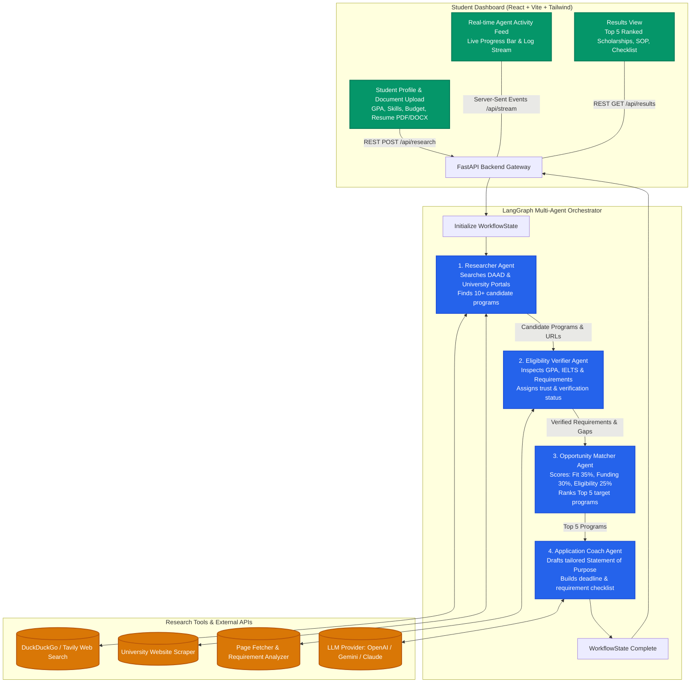

# ScholarSwarm AI — Agent Architecture & Workflow Diagram

This document contains visual diagrams explaining the architecture and coordination of the 4 AI agents in ScholarSwarm AI.

An SVG version is also available in [`agent_workflow_diagram.svg`](./agent_workflow_diagram.svg).

---

## 1. High-Level Flowchart

---

## 2. Sequence Diagram: Agent-to-Agent Execution

```mermaid
sequenceDiagram
    autonumber
    actor User as Student
    participant UI as React Frontend
    participant API as FastAPI Backend
    participant Graph as LangGraph Orchestrator
    participant R as Researcher Agent
    participant V as Eligibility Verifier
    participant M as Opportunity Matcher
    participant C as Application Coach

    User->>UI: Fills Profile & Uploads Resume
    UI->>API: POST /api/research (StudentProfile)
    API->>Graph: Initialize WorkflowState(session_id)
    API-->>UI: Return session_id & stream URL
    UI->>API: GET /api/stream/{session_id} (SSE)

    rect rgb(30, 41, 59)
        Note over Graph,R: Phase 1: Research
        Graph->>R: Execute research query
        R->>R: Search DuckDuckGo/Tavily, scrape portals
        R-->>Graph: Return 10+ Opportunity records
        Graph-->>API: Emit AgentEvent (researcher done)
        API-->>UI: SSE event: Researcher found 10 programs
    end

    rect rgb(30, 41, 59)
        Note over Graph,V: Phase 2: Verification
        Graph->>V: Inspect opportunities vs student profile
        V->>V: Verify CGPA, IELTS, and prerequisite gaps
        V-->>Graph: Return verified opportunities + status
        Graph-->>API: Emit AgentEvent (verifier done)
        API-->>UI: SSE event: Eligibility check complete
    end

    rect rgb(30, 41, 59)
        Note over Graph,M: Phase 3: Matching
        Graph->>M: Rank opportunities
        M->>M: Score (Academic, Funding, Eligibility, Career)
        M-->>Graph: Return Top 5 ranked opportunities
        Graph-->>API: Emit AgentEvent (matcher done)
        API-->>UI: SSE event: Top 5 opportunities selected
    end

    rect rgb(30, 41, 59)
        Note over Graph,C: Phase 4: Coaching
        Graph->>C: Generate SOP & Checklist
        C->>C: Draft personalized SOP & milestone checklist
        C-->>Graph: Return SOP and Checklists
        Graph-->>API: Emit AgentEvent (coach done)
        API-->>UI: SSE event: Workflow complete
    end

    UI->>API: GET /api/results/{session_id}
    API-->>UI: Return Complete WorkflowState JSON
    UI->>User: Display Top 5 Cards, Verified URLs, SOP & Checklist
```

---

## 3. Agent Responsibilities Breakdown

| Agent | Core Objective | Key Inputs | Output Artifacts | Anti-Hallucination Guardrails |
|-------|---------------|------------|------------------|-------------------------------|
| **1. Researcher Agent** | Find ≥ 10 real programs | Target Countries, Field of Study, Degree Level, Budget | 10+ `ScholarshipOpportunity` records with official URLs | Requires direct web links; rejects opportunities without official URLs |
| **2. Eligibility Verifier** | Validate constraints | Student CGPA, Language Scores, Opportunity Prerequisites | Verification status (`ELIGIBLE`, `LIKELY_ELIGIBLE`, `MISSING_INFO`) | If official requirements are inaccessible, flags as unverified |
| **3. Opportunity Matcher** | Rank programs by fit | Verified Opportunities, Student Goals, Budget | Ranked Top 5 opportunities with match score (0–100) | Multi-factor weighted arithmetic formula; deterministic ranking |
| **4. Application Coach** | Maximize admission chance | Top-ranked program, Student Projects, Skills, Resume text | Personalized Statement of Purpose (SOP) + Application Checklist | Grounded in student's verified projects and university faculty focus |
